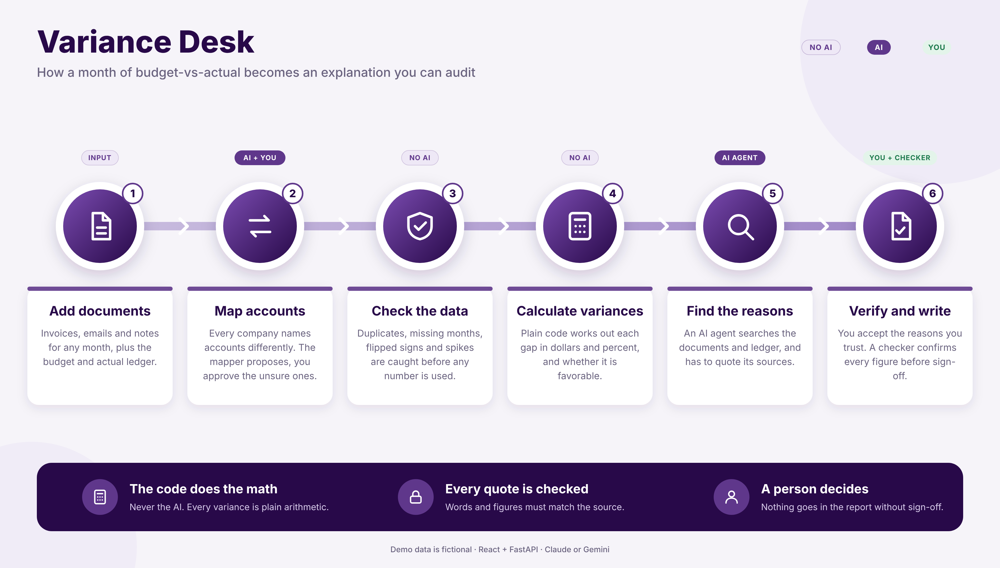
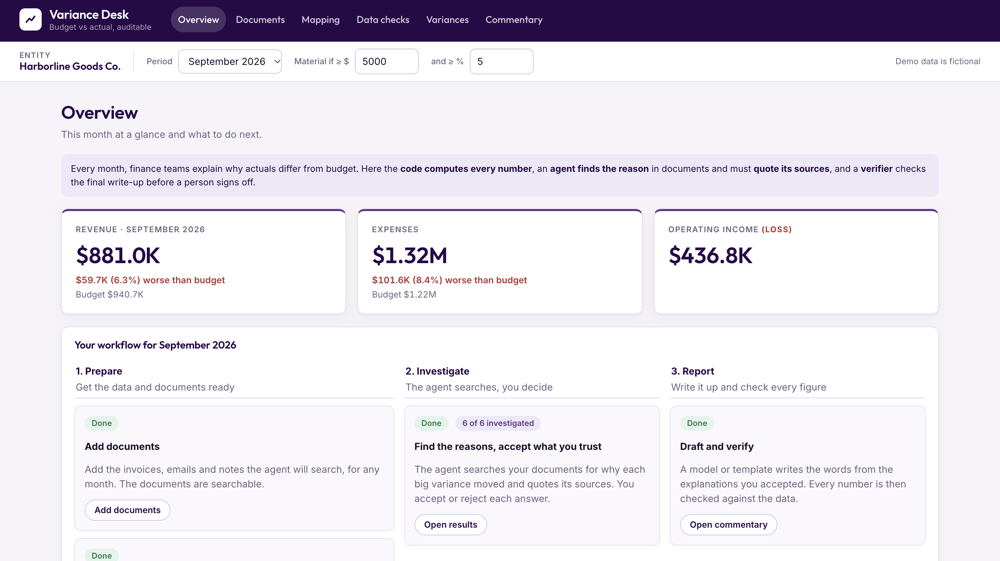

# Variance Desk

A small app that helps a finance team explain **why** actual numbers differ from the budget each month.

An AI agent searches invoices, emails and notes for the reason behind each big difference. Every number and quote it gives is checked against the source, and a person makes the final decision.

All data in this project is fictional.

## How it works

1. **Documents:** add the invoices, emails and notes to search.
2. **Mapping:** match each company's account names to one standard list.
3. **Data checks:** catch duplicates, missing months and other problems first.
4. **Variances:** the code works out the gaps, the agent finds the reasons with quotes, and you accept or change them.
5. **Commentary:** write the summary, then a checker verifies every figure.

The math is done by code, never by the AI.



## Run it

```bash
python3 -m venv .venv
source .venv/bin/activate
pip install -r requirements.txt
uvicorn gve.api:app --port 8000
```

Then open http://localhost:8000. It works without any key.

To turn on the AI agent, set a key in your terminal before starting the app (use your own key, and never save it in a file):

```bash
export GEMINI_API_KEY="your-key-here"
```

Or, if you use Claude: `export ANTHROPIC_API_KEY="your-key-here"`

## Good to know

- The AI agent was tested on a small set of cases, not at full scale.
- This is a prototype built to show an approach, not a finished product.



## Future ideas

- **OCR for scanned documents:** read scanned PDFs and photos of invoices, not just text-based files.
- **Connect to real systems:** pull the ledger and documents straight from accounting software and email, instead of uploading files by hand.
- **Save work and add login:** keep accepted reasons and mappings between sessions, and let a team use the app with their own accounts.

## License

MIT. See `LICENSE`.
